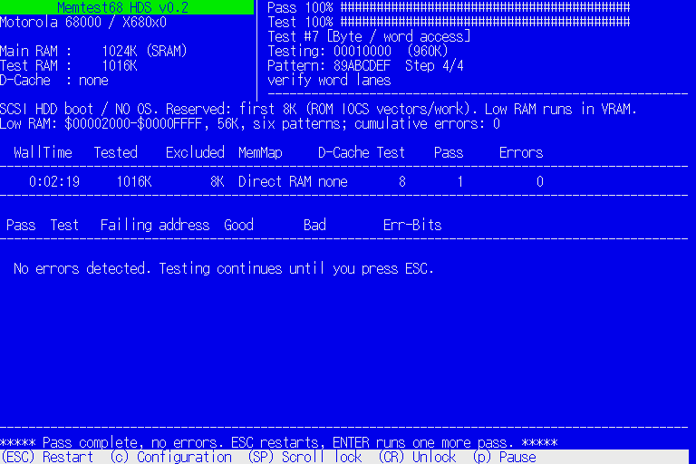

# memtest68k — Memtest68

X68000 / X68030 用のメモリ診断ツールです。Memtest86+ のクラシックな画面を参考に、青い画面へ Pass / Test の進捗、周回数、エラーのアドレス・期待値・実測値を表示します。

Human68k で実行する版と、OS をロードせず FD / SCSI HDD から直接起動する版があります。**実機では未検証です。** 現在の動作確認は XEiJ と run68x によるものです。



## 起動形式

| 形式 | ビルド成果物 | 起動方法・検査範囲 | 詳細 |
| --- | --- | --- | --- |
| Human68k | `build/memtest68.x` | DOS から確保できる通常 RAM を検査。OS・常駐ソフト・本体の使用領域は除外 | [操作・引数](docs/human68k.md) |
| FD 単独起動 | `build/memtest68-fd.xdf` | 1232 KiB XDF。先頭 8 KiB の ROM IOCS 用領域を除いて検査 | [FD 起動手順](docs/fd-boot.md) |
| SCSI HDD 単独起動 | `build/memtest68-hd.hds` | 16 MiB HDS。FD 版と同じ検査範囲。Human68k 不要 | [HDS 起動手順](docs/hds-boot.md) |

単独起動版は、通常領域に共通の 7 種類の検査を実行します。検査コード自身が使う低位 56 KiB は、コードと退避先をテキスト VRAM に移して専用の 6 パターンで検査します。既定の検査容量は 1 MiB 構成で 1016 KiB、4 MiB 構成で 4088 KiB です。

FD / HDS は診断専用イメージです。OS・ROM・Human68k のファイルシステムは含みません。HDS 版には SCSI ROM IOCS が必要で、SASI / HDF 用ではありません。

## ビルド

必要なもの:

- [elf2x68k](https://github.com/yunkya2/elf2x68k) の `m68k-xelf-gcc` と binutils、Newlib 環境
- GNU make、Python 3
- ホスト側テスト用の C コンパイラ（AddressSanitizer / UndefinedBehaviorSanitizer 対応）

```sh
git clone https://github.com/j3tm0t0/memtest68k.git
cd memtest68k
make
```

`build/` に `.x`・`.xdf`・`.hds` とデバッグ用 ELF を生成します。各起動イメージにはサイズ・チェックサム・SHA-256 を記録した JSON も生成します。

```sh
make fd      # FD 版だけを生成
make hds     # HDS 版だけを生成
make test    # ホスト側テスト
make check   # 全形式のビルドとテスト
```

`build/` は Git の管理対象外です。このリポジトリから各形式をビルドして使用してください。

## 実行例

Human68k では `memtest68.x` を転送して実行します。

```text
A>memtest68
A>memtest68 --passes 1 --size 1024
```

引数なしでは空き RAM を連続検査します。`--size` は KiB 単位です。検査対象の内容は上書きされます。

HDS 版を XEiJ の SCSI ID 0 から起動する例:

```sh
java -jar /path/to/XEiJ.jar \
  -ini="$PWD/build/hds-preview.ini" -saveonexit=off -config=default \
  -model=XVI -memory=2 -boot=sc0 \
  -sc0="$PWD/build/memtest68-hd.hds" -flrinformed=on
```

FD 版は `-boot=fd0 -fd0="$PWD/build/memtest68-fd.xdf"` を指定します。単独起動版の RAM 容量は SRAM の設定値を使用するため、物理搭載量と設定を合わせてください。

## 主な操作

| キー | 動作 |
| --- | --- |
| `c` | 設定画面。検査項目を切り替える |
| `p` | 一時停止 / 再開 |
| Space / Enter | エラー一覧の表示固定 / 固定解除 |
| ESC（Human68k 版） | 中断して DOS に戻る |
| ESC → `y`（FD 版） | FD から再起動 |
| ESC → `y`（HDS 版） | 起動した SCSI ID から診断本体を再ロード |

設定画面では `1`〜`7`（単独起動版は `8` も）で項目を選択し、Enter で再開します。選択変更は次の Pass から反映します。単独起動版は `l` で周回上限を設定できます。HDS の再ロードは診断プログラムの再スタートで、ハードウェア全体のリセットではありません。

## 検査項目

1. 自身のアドレスとアドレス反転
2. 全 0 / 全 1 の moving inversions
3. チェッカーボード `55555555` / `AAAAAAAA`
4. 32 ビットの walking ones / zeros
5. アドレスと周回 seed による疑似乱数パターン
6. March C-
7. バイト / ワード単位の書き込みと longword 確認
8. 低位 RAM の VRAM 退避検査（単独起動版のみ）

## 対応範囲と制限

- MC68000 命令でビルドし、標準 68000 と X68030 を対象としています。
- 68030 のデータキャッシュは無効にして検査します。68040 / 68060 のアクセラレータは未対応です。
- 通常 RAM のみを対象とします。VRAM・SRAM・ハイメモリは診断しません。単独起動版でも先頭 8 KiB は未検査です。
- バスエラーやアドレスエラーから継続検査へ復帰する機能はありません。
- DRAM の長時間保持試験、DMA 転送試験、故障した SIMM / チップ位置の特定は未実装です。
- エラー 0 でも途中終了した検査は合格を意味しません。エミュレータ上の成功は実機の正常性を保証しません。

## 検証と構成

XEiJ では FD / HDS からの起動、低位 RAM を含む全 8 項目の一周、故障注入時の検出、読込チェックサム、再起動 / 再ロードを確認しました。Human68k 版は run68x でも生成した 68000 バイナリを実行しています。対象構成・検査容量・結果は [検証記録](docs/verification.md) を参照してください。

| ディレクトリ | 内容 |
| --- | --- |
| `src/`・`include/` | 共通検査エンジン、Human68k フロントエンド |
| `boot/` | 自作 FD / HDS ローダ、単独起動フロントエンド、低位 RAM 検査 |
| `tools/` | ディスク生成、任意の [XEiJ 検証補助](tools/README.md) |
| `tests/` | 正常系・故障注入・境界・イメージ構成のホスト側テスト |
| `docs/` | 起動形式ごとの説明、検証記録、実画面 |

画面は Memtest86+ のクラシック UI を参考にした独自実装です。Memtest86 / Memtest86+ の移植版ではありません。
