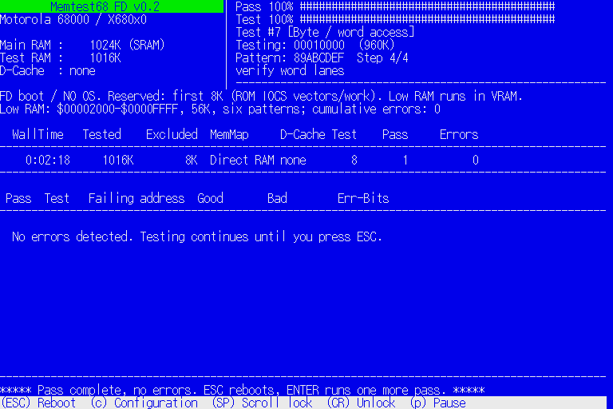
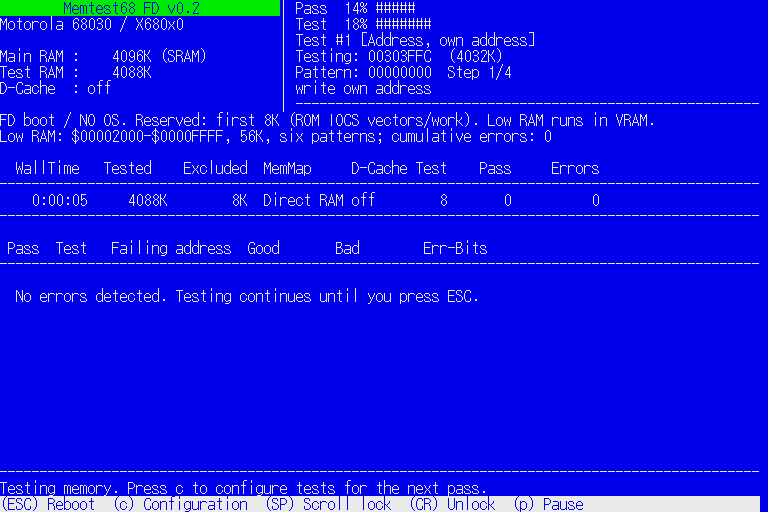
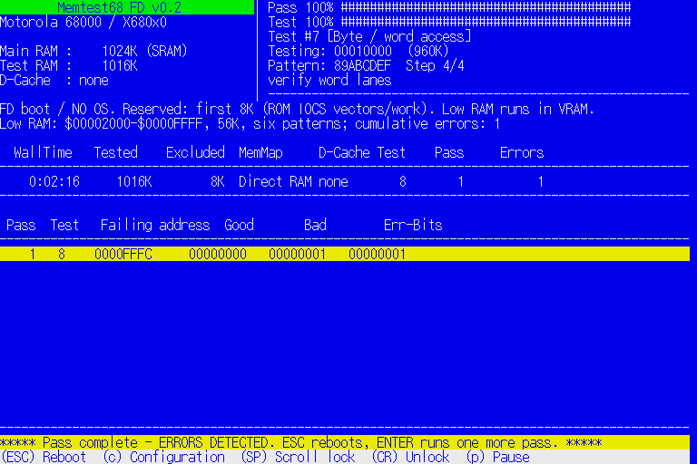

# FD 起動版 Memtest68 FD v0.2

`build/memtest68-fd.xdf` を FD ドライブに入れて起動すると、Human68k をロードせずに検査を始めます。OS・ROM の配布ファイルはイメージに含みません。

## 作成と起動

```sh
make fd
```

生成物:

- `build/memtest68-fd.xdf`: 1232 KiB の RAW XDF。77 シリンダ × 2 ヘッド × 8 セクタ × 1024 バイト。
- `build/memtest68-fd.json`: イメージの SHA-256、ロードサイズ、チェックサム。
- `build/boot/standalone.elf`: デバッグ用 ELF とシンボル。

XEiJ では XDF を FD0 に挿入して FD0 起動を選びます。FD1 から起動することも想定したローダです。実 FD への転送には、この 1232 KiB / 1024 バイトセクタ形式に対応したイメージ書き込みツールを使います。ファイルシステムは持たないため、Human68k の通常のファイルコピーでは起動 FD を作れません。

XEiJ 起動例（パスは利用環境に合わせて変更）:

```sh
java -jar /path/to/XEiJ.jar \
  -ini="$PWD/build/fd-preview.ini" -saveonexit=off -config=default \
  -model=XVI -memory=1 -boot=fd0 \
  -fd0="$PWD/build/memtest68-fd.xdf" -flrinformed=on
```

SRAM に設定された通常 RAM 容量を使用します。1〜12 MiB の整数 MiB に対応します。物理搭載量と SRAM の設定を合わせてください。68000 / 68030 を対象とし、68030 のデータキャッシュは検査開始前に無効化します。68040 / 68060 のアクセラレータとハイメモリは未対応です。

## 操作

| キー | 動作 |
| --- | --- |
| ESC | 再起動の確認。y で ROM から再起動する |
| c | 検査項目・周回数の設定 |
| 1〜8（設定中） | 検査項目を選択。変更は次の Pass から適用 |
| a（設定中） | 全項目を選択 |
| l（設定中） | 周回上限を 1 → 2 → 5 → 無制限に切り替える |
| Enter（設定中） | 再開。最低一つの項目が必要 |
| p | 一時停止 / 再開 |
| Space / Enter | エラー一覧の表示固定 / 固定解除 |
| Enter（周回上限到達後） | もう 1 周実行する |

初期状態は全 8 項目、無制限の連続検査です。再起動確認を取り消すと、途中の Pass を最初からやり直します。累積エラー数と完了 Pass 数は維持します。FD 起動版には復帰先の DOS がないため、ESC は DOS 終了ではありません。





## 検査範囲

| 領域 | 用途・検査 |
| --- | --- |
| `$00000000–$00001FFF` | ROM IOCS の割り込みベクタ・ワーク。8 KiB を検査対象外とする |
| `$00002000–$0000FFFF` | ローダ・検査コード・データ・スタック。検査 8 で実行場所と退避先を TVRAM に移して検査 |
| `$00010000–設定 RAM 上端` | Human68k 版と共通の検査エンジン。検査 1〜7 を全域に実行 |
| TVRAM plane 2 / 3 | 低位 RAM の検査コード・退避データ。検査中だけ使用する作業領域 |

既定では、1 MiB 構成なら **1016 KiB**、4 MiB 構成なら **4088 KiB** を検査します。先頭 8 KiB は未検査です。SRAM・VRAM・拡張ハイメモリ自体は診断しません。

検査 8 は低位 56 KiB を TVRAM plane 3 に退避し、plane 2 から位置非依存のアセンブリを実行します。割り込みを禁止し、全 0・全 1・`55555555`・`AAAAAAAA`・自身のアドレス・アドレス反転の 6 パターンについて書き込みと読み出しを行います。その後、元のコード・データ・スタック・CRTC 設定・レジスタ・割り込み状態を復元します。

検査 8 は検査 1〜7 と同じアルゴリズムではありません。すべての不一致を累積数に加え、その実行で最初の不一致を一覧に残します。低位 RAM の退避中も画面の色が変わらないよう、テキストパレットの上位プレーンを下位プレーンと同じ色に設定します。

バスエラーやアドレスエラーから継続検査へ復帰する機能はありません。検査コードを実行する RAM・退避に使う VRAM・ROM IOCS の故障により、停止や異常動作になることもあります。

## FD の内容と起動処理

1. ROM が FD の先頭 1024 バイトを `$2000` にロードして実行する。この起動仕様は [morian 氏の FD 起動解説](https://zenn.dev/morian/articles/ab313ec56c4c4f) と [NetBSD/x68k のブート解説](https://www.pastel-flower.jp/~isaki/NetBSD/x68k/boot2.php) を参照。
2. 自作 IPL が ROM IOCS `_BOOTINF` から起動ドライブを得て、`_B_READ` で後続のセクタを `$2400` に読み込む。シリンダ・ヘッド・セクタの境界をまたいで読み込む。
3. 32 ビット加算チェックサムを検証する。不一致なら本体を実行せず、エラー画面で停止する。読出し失敗時はセクタごとに 3 回試行する。
4. 自作スタートアップが BSS とスタックを初期化して検査本体を呼ぶ。DOS コールも Human68k の C ランタイムも使用しない。

IPL・検査本体・ディスク生成ツールはいずれもこのリポジトリのソースからビルドします。既存の Human68k 起動セクタを転用しません。チェックサムは読出しの破損検出用で、暗号学的な署名ではありません。

## 検証

`make check` は両形式のビルド、共通メモリ検査エンジンのテスト、FD イメージ構成・チェックサム・境界のテスト、画面用フォーマッタのテストを実行します。実行環境での結果は [検証記録](verification.md) を参照してください。

実機での検証は未実施です。



上のエラーは検証補助が注入したものです。配布する FD イメージに故障注入機能は含みません。
