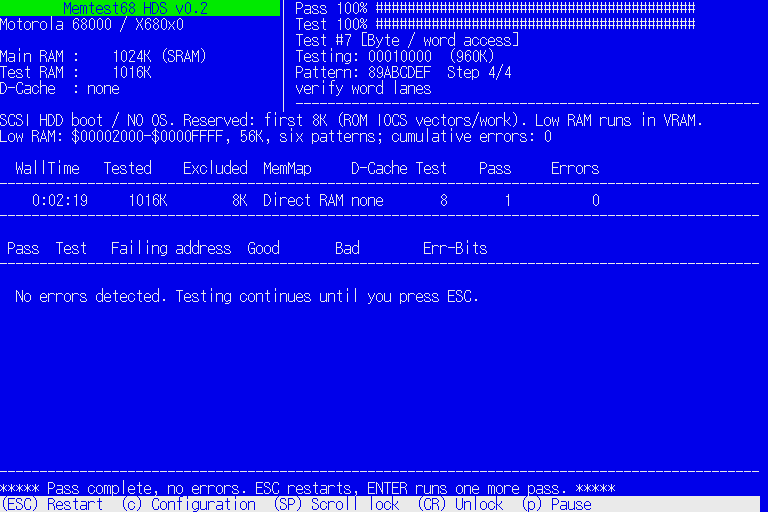

# HDS 起動版 Memtest68 HDS v0.2

`build/memtest68-hd.hds` は、SCSI HDD から Human68k を使わずに起動する **16 MiB の HDS イメージ**です。FD 版と同じメモリ検査本体を使用します。

## ビルドと起動

```sh
make hds
```

生成物:

- `build/memtest68-hd.hds`: 16 MiB、512 バイト物理ブロックの RAW SCSI イメージ。
- `build/memtest68-hd.json`: サイズ、ロード範囲、チェックサム、SHA-256。
- `build/boot/hds_standalone.elf`: デバッグ用 ELF。

XEiJ では HDS を SCSI HDD として接続し、その SCSI ID からの起動を選択します。FD は不要です。

```sh
java -jar /path/to/XEiJ.jar \
  -ini="$PWD/build/hds-preview.ini" -saveonexit=off -config=default \
  -model=XVI -memory=2 -boot=sc0 \
  -sc0="$PWD/build/memtest68-hd.hds" -flrinformed=on
```

SCSI ID 3 に接続する場合は、`-sc3=... -boot=sc3` を指定します。ローダは SCSI ROM が渡した起動 ID を使って本体を読みます。内蔵 SCSI または SCSI ROM が提供する ROM IOCS が必要です。SASI / HDF や SxSI 導入前の SASI ポート用イメージではありません。

このイメージは診断専用です。Human68k のファイルシステム・通常の起動パーティション・OS ファイルは含みません。既存 HDD の空きパーティションへインストールする形式ではありません。

## 検査と操作

初期状態では全 8 項目を繰り返し実行します。`c` で項目と周回数を設定し、`ESC` → `y` で起動した SCSI ID の HDS から診断本体を再ロードします。これは診断プログラムの再スタートで、ハードウェア全体のリセットではありません。RAM 範囲、VRAM へ移して行う低位 RAM の検査、CPU・キャッシュ制御は [FD 版](fd-boot.md) と同じです。先頭 8 KiB の ROM IOCS 用領域は検査しません。



## ディスク構成

| オフセット | 内容 |
| --- | --- |
| `$0000` | `X68SCSI1` ヘッダ。物理ブロック 512 バイト、ブロック数 32768 |
| `$0400` | 自作の SCSI ディスク IPL、1024 バイト |
| `$0800` | `X68K` 空パーティション表ヘッダ。通常のパーティションは作らない |
| `$8000` | 診断本体。512 バイト境界までゼロ埋め |

SCSI ROM がディスク IPL を `$2000` へ読み込み、IPL は ROM IOCS `_SCSIDRV` / `_S_READ` で本体を `$2400` へ読み込みます。起動 ID を RAM `$2030` に保持し、再スタートでも同じ ID を使用します。読出しは最大 3 回試行し、32 ビット加算チェックサムの不一致なら本体を実行せず停止します。エラー画面でキーを押すと同じ ID から再試行します。検査中にディスクへ書き込む処理はありません。

ヘッダ構成は [XEiJ](https://stdkmd.net/xeij/) 0.26.10.08 の `SPC.java` / `SCMedia.java`、SCSI 起動時の ID と ROM IOCS の使い方は [PiPAPo の X68000 移植記録](https://github.com/toyoshim-i/PiPAPo/blob/main/docs/proposals/x68k_port.md) を参考にしています。既存の起動セクタや OS バイナリは転用していません。

`make check` で共通エンジン、FD / HDS の構成・サイズ・チェックサム・境界、画面フォーマッタを検証します。エミュレータでの結果は [検証記録](verification.md) を参照してください。実機・実 HDD での検証は未実施です。
