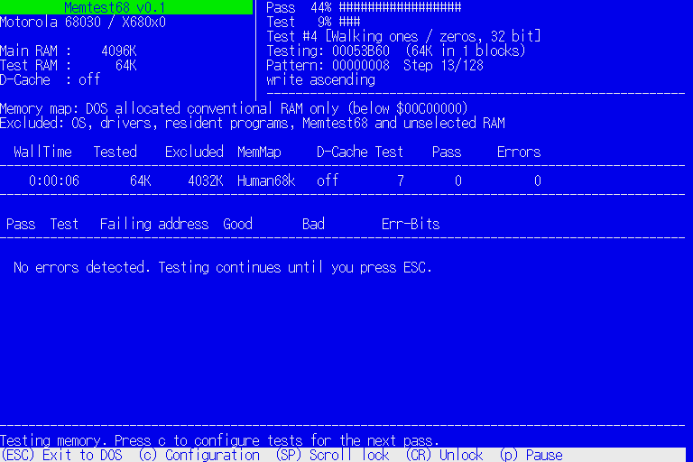
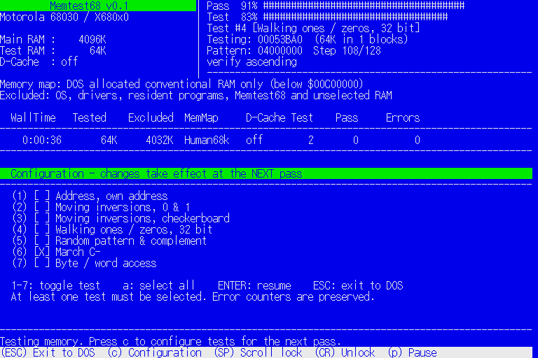
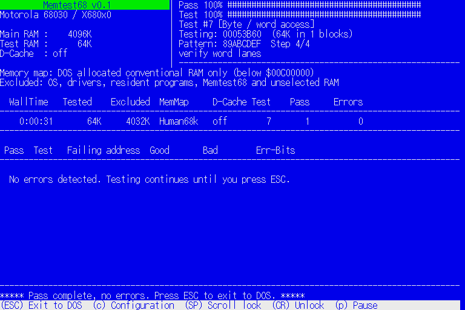

# Human68k 版 Memtest68

X680x0 / Human68k 用の RAM 診断ツールです。Memtest86+ のクラシックな画面を参考に、青地・緑のタイトル帯・Pass / Test の進捗バー・エラー一覧を表示します。

**Human68k から実行する `.X` 形式**、**OS を使わず FD から直接起動する XDF 形式**、**SCSI HDD から直接起動する HDS 形式**を用意しています。単独起動版は [FD 版](fd-boot.md)・[HDS 版](hds-boot.md) を参照してください。以下は Human68k 版の説明です。

## 起動

`build/memtest68.x` を X680x0 に転送して実行します。

```text
A>memtest68
```

引数なしで、DOS から確保できる通常 RAM を検査し続けます。起動時の確認操作はありません。検査ブロックの中身は上書きされますが、OS・ドライバ・常駐ソフト・本プログラムの使用領域は確保対象から外れます。

| キー | 動作 |
| --- | --- |
| ESC / q | 検査を中断し、Human68k に戻る |
| c | 設定画面。検査を一時停止する |
| 1〜7（設定画面） | 各検査の有効・無効を切り替える |
| a（設定画面） | 全検査を選択する |
| Enter（設定画面） | 再開。変更は次の Pass から適用する |
| Space | エラー一覧の表示を固定・解除する。検査と集計は続行する |
| Enter | エラー一覧の表示固定を解除する |
| p | 一時停止。もう一度 p で再開する |

ESC は再起動ではなく DOS への復帰です。設定画面で全検査を外した場合、少なくとも一つ選ぶまで再開できません。

```text
memtest68 --size 1024                 1 MiB を連続検査
memtest68 --passes 1                  1 周で停止し、結果画面を表示
memtest68 --tests 126                 アドレス・0/1 反転・March C- を検査
memtest68 --plain --passes 2 --size 64 ログ形式で 64 KiB を 2 周検査して終了
memtest68 --help
```

`--size` の単位は KiB、上限は 12288 です。指定した容量を確保できなければ検査を開始しません。`--passes 0` は無制限です。`--plain` では有限の `--passes` が必要です。ログ形式はキー操作を受け付けず、自動終了します。

終了コード: 0 = 指定周回完了・不一致なし、1 = メモリ不一致検出、2 = 引数・確保・対応環境のエラー、130 = キー操作による途中終了。不一致があれば途中終了でも 1 になります。**途中終了でエラーが 0 でも合格を意味しません。**

## 画面

画面は 768 × 512、96 桁 × 32 行です。実行中は画面モードとテキストパレットを変更し、終了時に元の設定へ戻します。起動前の画面内容は復元しません。

- 左上: CPU、SRAM に設定されたメイン RAM 容量、実際に確保した検査容量、データキャッシュ状態。
- 右上: Pass / Test 進捗、現在のテスト、アクセス位置、パターン、処理方向。
- 中央: 経過時間、検査対象・対象外の容量、有効テスト数、完了 Pass 数、累積エラー数。
- 下部: 直近 12 件の不一致。アドレス・期待値・実測値・XOR による相違ビットを表示。

Pass は有効な全検査を終えた時点で加算します。Pass バーは各検査を均等な割合として表示し、残り時間の予測ではありません。Walking bits はほかの検査より長くかかります。経過時間には設定画面と一時停止の時間も含まれます。







## 検査内容

| 番号 | 検査 | 内容 |
| --- | --- | --- |
| 1 | Address, own address | 各 longword に自身のアドレスとその反転を書き、逆順に確認 |
| 2 | Moving inversions, 0 & 1 | 全 0 / 全 1 を昇順・降順で確認しながら反転 |
| 3 | Checkerboard | `55555555` / `AAAAAAAA` を同様に反転検査 |
| 4 | Walking ones / zeros | 32 ビットそれぞれについて、単一ビットとその補数を全対象領域で反転検査 |
| 5 | Random pattern | アドレスと周回ごとの seed から生成する疑似乱数とその補数を検査 |
| 6 | March C- | 全域 w0 → 昇順 r0/w1, r1/w0 → 降順 r0/w1, r1/w0 → 全域 r0 |
| 7 | Byte / word access | バイト単位・ワード単位で異なるレーンの値を書き、longword で確認 |

複数の DOS ブロックを確保した場合も、一つの書き込み段階を全ブロックに適用してから読み出し段階に進みます。これによりブロック間のアドレスの重複応答も検出対象にします。アクセスには `volatile` を使用し、コンパイラによる読み書きの省略を防ぎます。

## 対象・制限

- MC68000 命令でビルドします。標準 68000 と X68030 を対象とし、68010 / 68020 も命令上は対応します。
- 68030 では ROM IOCS 経由でデータキャッシュを無効にして検査し、終了時に元の設定へ戻します。命令キャッシュの有効状態は維持します。
- 68040 / 68060 等のアクセラレータは、この版ではキャッシュ制御に未対応のため検査を開始しません。
- DOS `_MALLOC` で確保でき、かつ `$00C00000` 未満に収まるブロックだけを検査します。最大 64 ブロックです。実際の検査容量を画面に表示します。
- OS・常駐ソフト・プログラム本体の領域、確保できない領域、VRAM、SRAM、ハイメモリは検査しません。Main RAM は SRAM の設定値であり、物理搭載量の自動検出ではありません。
- RAM の不一致は通常の読み出しで検出します。バスエラーやアドレスエラーを独自に捕捉・復帰する機能はありません。
- DRAM の長時間保持試験、DMA 転送試験、SIMM のスロット／チップ位置の特定は未実装です。
- エミュレータ上の成功は、実機の RAM・キャッシュ・バスの正常性を保証しません。

## ビルドと検証

[elf2x68k](https://github.com/yunkya2/elf2x68k) の `m68k-xelf-gcc` と GNU make が必要です。Newlib 環境を使用します。

```sh
make
make test
make check
```

`make` で `build/memtest68.x`、`build/memtest68-fd.xdf`、`build/memtest68-hd.hds` とデバッグ用 ELF を生成します。`make fd` / `make hds` で各単独起動版を個別にビルドできます。ホスト側テストは C コンパイラと AddressSanitizer / UndefinedBehaviorSanitizer を使い、7 種の正常系・意図的破損の検出・期待値と実測値の報告・中断・範囲外書き込み防止・不正範囲・カウンタ飽和を確認します。

[run68x](https://github.com/kg68k/run68x) があれば、生成した **68000 バイナリそのもの**も検証できます。

```sh
run68 build/memtest68.x --plain --passes 2 --size 16
run68 build/memtest68.x --plain --passes 1 --tests 1
```

画面確認には [XEiJ](https://stdkmd.net/xeij/) と別途用意した Human68k 起動ディスクを使います。検証時はディスクのコピーに `MEMTEST68.X` を入れ、専用の `-ini` と `-saveonexit=off` で起動します。OS や ROM はこのリポジトリに含めません。

`tools/XEiJBridge.java` は任意の開発補助です。XEiJ の公開 Java API を通じてキー入力とエミュレータ表示部分の PNG 保存を行います。ビルド例と起動例は [tools/README.md](../tools/README.md) を参照してください。

## FD 単独起動版

`boot/` に自作の FD ローダと OS に依存しないフロントエンドを実装しています。通常領域は共通エンジン `src/memtest.c` で検査し、本体が使う低位 56 KiB は VRAM から実行する専用の 6 パターンで検査します。先頭 8 KiB の ROM IOCS 用領域は残します。詳しくは [FD 起動版](fd-boot.md) を参照してください。
