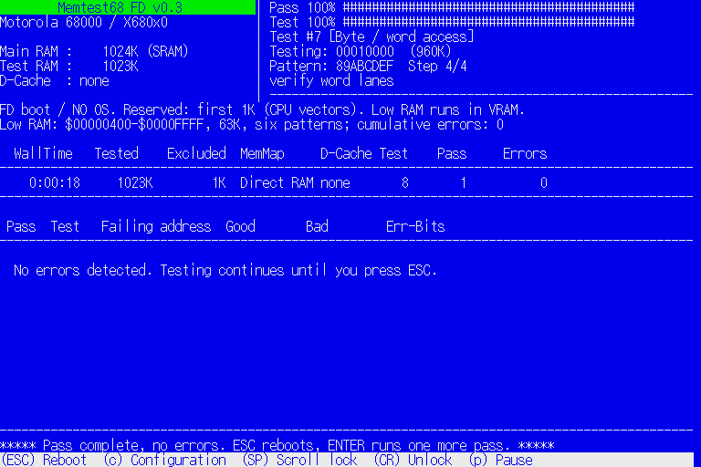
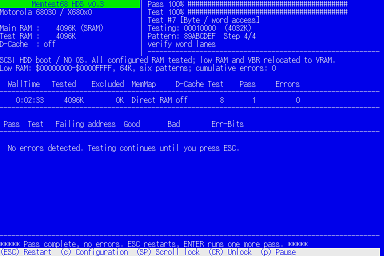
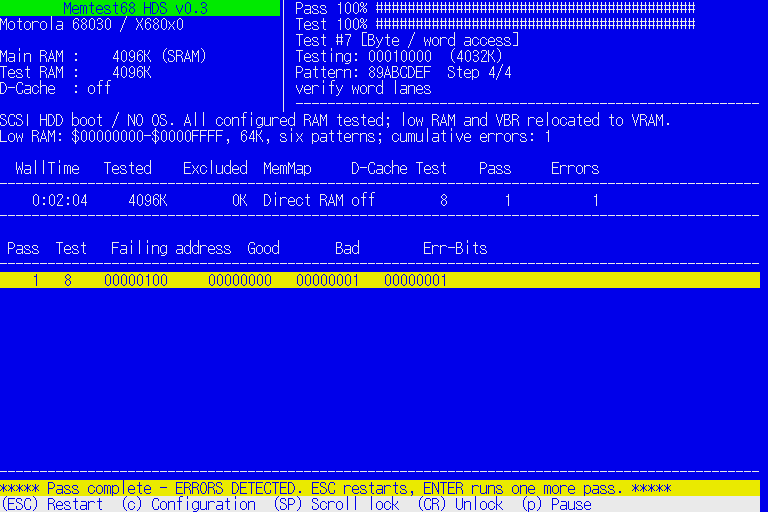

# 検証記録

## 実機での確認（利用者報告）

2026-11-26、利用者から次の動作確認を報告いただきました。

| 機種・CPU | RAM | 起動形式 | 結果 |
| --- | --- | --- | --- |
| X68000 XVI / 68000 / 16 MHz | 12 MB（2+2+8） | Human68k / HDS | 各 1 周、エラーなし |

先頭 8 KiB を除外する v0.2 の報告です。v0.3 の検査範囲拡張を実機で確認した記録ではありません。FD 起動の実機確認も含みません。

## 初版の開発環境での確認

以下は 2026-11-26 時点の初版で実施した内容です。

| 環境 | 内容 | 結果 |
| --- | --- | --- |
| macOS / C / ASan / UBSan | 全 7 検査、意図的破損、報告値、中断、ガード領域、不正範囲、エラー数飽和 | 成功 |
| elf2x68k GCC 13.5.0 | `-m68000 -O2 -Wall -Wextra -Werror` | X 形式生成成功 |
| run68x `fc28826` | 生成バイナリ、16 KiB、全 7 項目 × 2 Pass | エラー 0、終了コード 0 |
| run68x `fc28826` | 容量指定なし、通常 RAM の確保可能領域全体、アドレス検査 × 1 Pass | 11998 KiB、エラー 0、終了コード 0 |
| run68x `fc28826` | ヘルプと不正引数 6 ケース | 想定した終了コード |
| XEiJ 0.26.10.08 / XVI / RAM 4 MiB / Human68k 3.02 | 1 MiB 検査の進捗表示、c による設定表示、ESC 中断 | DOS プロンプトへ復帰、パレット復帰 |
| XEiJ 0.26.10.08 / X68030 / RAM 4 MiB / Human68k 3.02 | 64 KiB、全 7 項目 × 1 Pass | D-cache off、エラー 0、完了画面表示、ESC 復帰 |
| 同上 | 長い引数での連続実行、p で一時停止・再開、c で検査を切り替え | 次の Pass に March C- のみを適用、2 Pass 完了・エラー 0 |
| 同上 | 完了画面から ESC で DOS へ復帰後、キーボード入力で `--size 64 --tests 6 --passes 1` を指定して再起動 | March C- 完了、エラー 0 |

画面画像は XEiJ の実行画面を保存したものです。モック画像ではありません。ブート用ディスクは既存の Human68k 3.02 ディスクのコピーを使い、専用の設定ファイルを指定しました。

貼り付けパイプとキー操作を併用した試行では、DOS シェルの入力処理中にアドレスエラーが発生しました。貼り付けパイプを外した環境で、バッチからの連続起動と通常キー入力での再起動をやり直し、正常終了を確認しました。この異常の原因は特定していません。

ビルド成果物 `build/memtest68.x` の SHA-256:

```text
ed9cce8b52001c10014637c05695ec0c20684957ffb52f465c09530f6c49c20d
```

## FD 起動版 v0.2

2026-11-26、Human68k を含まない自作 XDF で実施。XEiJ 0.26.10.08 / IPL ROM 1.6 を使用しています。

| 環境・試験 | 結果 |
| --- | --- |
| `make check` | 両形式の生成、共通エンジンの ASan / UBSan テスト、画面用フォーマッタ、FD イメージ生成の 3 テストが成功 |
| 68000 / XVI / 1 MiB / 検証用 100 MHz 設定 | FD0 から OS なしで起動。全 8 項目が 1 周完了。検査 1016 KiB、対象外 8 KiB、エラー 0 |
| X68030 / 4 MiB / 標準クロック | FD0 起動、D-cache off、低位 56 KiB の VRAM 退避・検査・復元後に通常領域のアドレス・反転検査が進行。全周回完了の確認はしていない |
| 故障注入 / 68000 / 1 MiB | VRAM 上の低位検査中に `$FFFF` の 1 ビットを一度だけ反転。Test 8 が `$0000FFFC` / Good=`00000000` / Bad=`00000001` / XOR=`00000001` を検出。退避したスタックを復元し、全 8 項目を 1 周完了。総エラー数は注入した 1 件のみ |
| 読込破損 / FD1 起動 | ペイロードの 1 バイトを変更した検証用 XDF で `PAYLOAD CHECKSUM ERROR` を表示。本体は実行しない |
| ESC 再起動 / 68000 | 確認画面で y を入力し、ROM IOCS `_IPLERR` 経由で FD を再読込。経過時間・エラー数・Pass 数が初期化され、検査が再開 |
| スタンドアロン ELF | エントリ `$2400`、未解決シンボルなし、DOS コール・Human68k スタートアップなし。コードと BSS / スタックはリンク時に先頭 64 KiB 以内へ制限 |

FD の最終 SHA-256 とサイズはビルド時に `build/memtest68-fd.json` へ出力します。実 FD / 実機での起動・検査は未実施です。

## SCSI HDS 起動版 v0.2

2026-11-26、16 MiB / 512 バイト物理ブロックの自作 HDS で実施。XEiJ 0.26.10.08 / IPL ROM 1.6 を使用しています。

| 環境・試験 | 結果 |
| --- | --- |
| `make check` | Human68k / FD / HDS の生成、共通 C テスト、FD / HDS 各 3 件の生成テストが成功 |
| SCSI ID 0 / XVI / 68000 / 1 MiB / 検証用 100 MHz 設定 | OS なしで起動し、低位 56 KiB を含む全 8 項目を 1 周完了。検査 1016 KiB、対象外 8 KiB、エラー 0 |
| SCSI ID 3 / 読込破損 | ペイロードの 1 バイトを変更した HDS から `PAYLOAD CHECKSUM ERROR` を表示。起動 ID 3 から正しく読込み、本体は実行しない |
| SCSI ID 3 / 再スタート | ESC → y で起動した ID 3 から本体を再ロードし、検査が再開。その後全 8 項目を 1 周完了、エラー 0。RAM `$2030` に保持した ID が 3 であることも確認 |
| FD 互換性 | 共通画面を HDS 対応させた後も FD イメージの SHA-256 は `cfad030aa87f68480ecbf849cd7488d10cb7b6c2b89edf5a741bbd383eeec44f` のまま |

最終 HDS の SHA-256 とサイズは `build/memtest68-hd.json` を参照してください。開発側での実 HDD・SASI / SxSI の検証は未実施です。実機 HDS の利用者報告は冒頭を参照してください。

SCSI HDS では ROM IOCS `_IPLERR` を使う共通再起動経路が起動エラーになったため、HDS ローダに起動 ID を保持し、同じ ID から診断本体を再ロードする方式にしました。ハードウェア全体のリセットではありません。


## v0.3：検査範囲拡張・headless XEiJ

2026-11-26、Linux aarch64 / Eclipse Temurin 26.0.2.1 / Xvfb / XEiJ 0.26.10.08 で、ソースから生成した FD / HDS を直接起動しました。検証用クロック設定は 1000 MHz です。実機の速度評価ではありません。

| 起動形式 | CPU / RAM | 結果 |
| --- | --- | --- |
| FD0 | 68000 / XVI / 1 MiB | 全 8 項目 × 1 周、検査 1023 KiB、未検査 1 KiB、エラー 0 |
| SCSI ID 3 / HDS | 68000 / XVI / 1 MiB | 全 8 項目 × 1 周、検査 1023 KiB、未検査 1 KiB、エラー 0 |
| FD0 | X68030 / 4 MiB | 全 8 項目 × 1 周、4096 KiB 全域、エラー 0 |
| SCSI ID 3 / HDS | X68030 / 4 MiB | 全 8 項目 × 1 周、4096 KiB 全域、エラー 0 |
| FD0 / 故障注入 | 68000 / 1 MiB | `$1000` の 1 ビット誤りを Test 8 が 1 件検出、全 8 項目 × 1 周完了 |
| HDS / 故障注入 | X68030 / 4 MiB | `$100` の 1 ビット誤りを Test 8 が 1 件検出、全 8 項目 × 1 周完了 |

全 6 ケースで、先頭 64 KiB の退避イメージとの復元照合は不一致 0、低位検査の終了状態は正常でした。68030 の実 CPU レジスタで VBR=`$E41000` を確認し、検査後は元の `$0` に戻ることも確認しました。68000 は実際の照合開始アドレスが `$400`、68030 は `$0` であることをブレークポイントで確認しています。故障注入の Good=`00000000` / Bad=`00000001` とアドレスは実画面でも確認しました。

[ケース別の結果 JSON](results/xeij-v03/) に、検査値と実行イメージ・ELF・XEiJ jar の SHA-256 を保存しています。これらはローカル Linux コンテナでの記録です。GitHub Actions の実行結果・ログ・画像は各 CI run の Artifacts を参照してください。







v0.3 の検査範囲拡張は実機未確認です。実機報告は冒頭の v0.2 の記録を参照してください。
